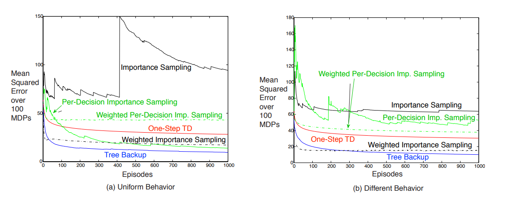

## Eligibility Traces for Off-Policy Policy Evaluation

paper Link: [Eligibility Traces for Off-Policy Policy Evaluation](http://incompleteideas.net/papers/PSS-00.pdf)
GITHUB Link:

### 1. 问题设定

- 行为策略 $\mu(a|s)$ 产生轨迹
- 目标策略 $\pi(a|s)$  待评估
- 在线、增量、单趟（one-pass）地估计 $V^\pi(s)$ 或 $Q^\pi(s,a)$
- 引入 eligibility trace $e_t$ 实现 多步回报 与 低方差 的平衡

汇总算法
| 符号                     | 含义        |   
| ---------------------------------------- | -------------------- |
| $\rho_t = \pi(a_t\| s_t)/\mu(a_t \| s_t)$ | 重要性采样比 |
| $\delta^{IS}_t = r_{t+1} + \gamma V(s_{t+1}) - V(s_t)$ | IS-TD 误差      | 
| $\delta^{PD}_t = r_{t+1} + \gamma \rho_{t+1} V(s_{t+1}) - V(s_t)$ | PD-TD 误差      |
| $\delta^{TB}_t = r_{t+1} + \gamma \sum_a \pi(s_{t+1}, a) V(s_{t+1}) - V(s_t)$ | TB-TD 误差      | 
| $e_t \in \mathbb{R}^d$     | eligibility trace 向量 | 
| $λ \in [0,1]$     | 迹衰减系数         | 

| 算法    | 需要 μ 概率 | 迹权重  | 更新乘子   | 无偏条件 | 方差趋势 | 内存     |
| ----- | ------- | ---- | --------------------- | ---- | ---- | ------ |
| IS-λ  | ✅ | $\rho_t$ | $\rho_t \delta^{IS}_te_t$    | λ=1  | 爆炸   | O(d)   |
| WIS-λ | ✅ | $\rho_t$ | $(\rho_t \delta^{IS}_t e_t)/M_t$ | 渐近   | ↓  | O(d+1) |
| PD-λ  | ✅ | $\rho_t$ | $\delta^{PD}_t e_t$     | λ=1  | 中    | O(d)   |
| TB-λ  | ❌ | $\pi_t$ | $\delta^{TB}_t e_t$      | λ=1  | 低    | O(d)   |

###  2. Importance-Sampling Algorithms
核心思想：把整条轨迹的回报用 重要性采样比 $\rho$ 加权，再用迹向量在线累积。

#### 2.1 基本 IS  
- 迹定义
  - $e_t = \gamma \lambda \rho_t e_{t-1}$

- TD error 【无$\rho$】:
  - $\delta _t = r_{t+1} + \gamma Q_t(s_{t+1}, a_{t+1}) - Q_t(s_t, a_t) == r_{t+1} + \gamma V_t(s_{t+1}) - V_t(s_t) $

- 更新action-value function 【有$\rho$】：
  - $Q_{t+1} = Q_t + \alpha \rho_t \delta_t e_t$

- 性质
✅ 无偏（$\pi$ 下期望与 MC 一致）
❌ 方差随轨迹长度指数增长（$\prod \rho_{0:t} \rightarrow \infin$）

#### 2.2 加权 $IS / WIS-\lambda$
用 累积比重的倒数 做归一化因子，降低方差
- 在线实现需维护 加权迹 
  - $M_t = \gamma \lambda \rho_t M_{t-1} + 1$
- 更新action-value function 【有$\rho$】：
  - $Q_{t+1} = Q_t + \alpha \rho_t \delta_t e_t / M_t$

- 性质
✅ 方差 ↓，仍渐近无偏
❗ 需要存储额外标量 $M_t$，且对非线性逼近收敛保证弱

### 3. Per-Decision Importance Sampling Algorithms

> **动机**: IS 把 整条轨迹 一起加权，方差大。
> **核心**: Per-decision只把 当前步 $ρ$ 放进 回报，而非整条轨迹；等价于 一步 IS + 多步 TD。

#### 3.1 PD(λ) 迹

- 迹定义 与 IS 相同：（负责纠正历史特征的权重）
  - $e_t = \gamma \lambda \rho_t e_{t-1}, \forall s, a$

- TD error: 单步重要性采样 【有$\rho$】：（负责纠正奖励/价值）
  - $\delta _t = r_{t+1} + \gamma \rho_{t+1} Q_t(s_{t+1}, a_{t+1}) - Q_t(s_t, a_t)$

- 更新action-value function 【无$\rho$】：
  - $Q_{t+1} = Q_t + \alpha \delta_t e_t$

- 性质
  - $λ=1$ 时无偏；$λ<1$ 引入 λ-加权偏差
  - 方差 比 IS-λ 小一个轨迹长度因子
  - 线性逼近下 收缩算子，收敛到 λ-加权 Bellman 误差 最小值 
    - 与 $IS-λ$ 相比，方差 ↓×轨迹长度，偏差 ↑×(1-λ)。

#### 3.2 现代技术中不用PD的原因

> 「裁剪 IS」= 实现简单 + 可微 + 生态成熟，而 PD-IS 的降方差优势在现代 大 batch + clip + GPU 场景下 聊胜于无，于是被生态淘汰。

工程与算法生态 发生了三点根本变化：
1. 方差问题靠「裁剪/正则」解决，而非「改公式」
   1. IS 的 ρ² 爆炸方差确实恐怖，但 PPO、TRPO、IMPALA 等直接用 clip(ρ, 1±ε) 或 bias-corrected ρ̂ 把权重硬压到有限区间
   2. 方差被 人工截断 控制，同时 保持可微、易实现
2. 现代流水线需要 可微、端到端
   1. IS 形式 $\rho = \frac{\pi_\theta}{\mu_{\theta_{old}}}$ 是 θ 的显式函数，可以 自动微分 穿过整个轨迹
   2. PD-IS 把 ρ 拆进 $\delta$内部，导致 $\delta$ 也含 $\theta$，反向传播时要 再求一次 $\delta$ 对 $\theta$ 的导数，实现复杂且 Hessian 不稳
   3. 在大 batch + GPU 场景，「整条轨迹一次乘 ρ」 比 「每步拆 δ」 更快更内存友好
3. 算法生态「以 IS 为原子」已成型
   1. Retrace、V-trace、IMPALA、ACER、SAC(off-policy) 都把 clip-ρ 作为 基础乐高块
   2. 这些高级变体 在 IS 框架内 就能达到 Bias-Variance 最优，PD-IS 的额外降方差 边际收益低
   3. 社区工具链（RLlib、Tianshou、Acme）默认提供 clip-ρ 算子，IS 即插即用；**PD-IS 需要 重写轨迹反向逻辑，无人愿意维护**

### 4. Tree-Backup Algorithms

核心思想：不需要 权重 $\mu$ 的概率！用 目标策略 $\pi$ 的概率 直接对回报做 加权树回溯，天生 off-policy。

#### 4.1 Tree-Backup λ (TB-λ)
- 迹定义
  - $e_t = \gamma \lambda \pi_t e_{t-1}$
  - 定义 $\pi$-权重 $\pi_t = \pi(a_t|s_t)$

- TD error: 单步重要性采样：（负责纠正奖励/价值）
  - $\delta _t = r_{t+1} + \gamma\sum_a \pi(s_{t+1}, a) Q_t(s_{t+1}, a_{t+1}) - Q_t(s_t, a_t)$

- 更新action-value function：
  - $Q_{t+1} = Q_t + \alpha \delta_t e_t$

一句话总结
- IS-λ：最纯正 off-policy，$\rho$ 加权整条轨迹，无偏但方差爆炸。
- PD-λ：只把当前步 $\rho$放进回报，方差 ↓，收敛保证仍在。
- TB-λ：甩掉 μ，用 $\pi$ 概率做树回溯，无需行为策略概率，最适合 **深度策略 + 高维动作 的 off-policy 学习。**

Tree-Backup 提出 “用 $\pi$ 概率加权回溯” 来摆脱 μ；AlphaZero 的 MCTS Backup 正是这一思想在 完美信息博弈+深度网络 上的工程化实现，两者共享 $\pi$-加权、无 $μ$、低方差 的同一血统。

| 维度            | Tree-Backup λ (RL)     | MCTS Backup (Planning)           |        
| ------------- | ---------------------- | -------------------------------- |  
| **目的**        | 在线 **off-policy 策略评估** | 决策时 **规划最优动作**                   |  
| **权重来源**      | **π(a\| s)**（目标策略概率）                   | **访问计数 N(s,a)**（UCB 驱动的频率） |
| **Backup 方向** | **时间反向**（沿轨迹 t→t-1→…）  | **树反向**（沿搜索路径 叶→根）               | 
| **Backup 内容** | **λ-加权 TD 误差**         | **蒙特卡洛回报** 或 **神经网络估值 v\_θ**     |      
| **是否用 μ**     | ❌ 完全不需要行为策略            | ❌ 自对弈，μ≡π                        |       
| **是否用 λ**     | ✅ 显式 $\lambda \in [0,1]$ 控制衰减     | ❌ 隐式 λ=1（MC）或 λ=0（叶节点 bootstrap） |    
| **是否在线**      | ✅ 单趟轨迹即可更新             | ✅ 每仿真结束后立即 Backup                |    
| **数学形式**      | 迹向量 $e_{t} = \gamma \lambda \pi_t e_{t-1}$  | $Q(s,a) \leftarrow (N·Q + v)/(N+1)$         |      
| **方差控制**      | π-加权，**零 IS 方差**    | 访问频率自动降低方差                       |   

MCTS Backup 可视为「λ=1 的 MC 版 Tree-Backup」在树结构上的工程化实现：二者都用 目标策略概率（$\pi$ 或访问频率） 加权回溯，彻底抛弃行为策略 μ，从而天然适合 完全自对弈 的 off-policy 场景 
